## Diagramme

```mermaid
classDiagram
    direction LR
    class Run {
        -RunStatus run_status
        -DateTime started_at
        -DateTime finished_at
        -Integer matched_name_count
        -Integer matched_fqdn_count
        -Integer matched_ip_count
        -Integer no_match_count
        -String error_message
        -Integer current_step
        -Integer completed_steps
        -RunTrigger run_trigger
        +start() void
        +collectAssets() void
        +collectIpamRecords() void
        +reconcileObservations() void
        +detectDuplicates() void
        +finish() void
        +fail() void
        +compareWith(otherRun) void
        +purgeOldRuns(retainCount) void
        +reportProgress() Integer
    }
    class Asset {
        -String vm_id
        -String virtual_source
        -String vm_name
        -String fqdn
        -String ip_reported
        -String node
        -AssetType asset_type
        -String asset_status
        -String asset_tags
        -String asset_role
        -String os
        -String annotation
        -Decimal cpu
        -Decimal ram
        -Decimal disk
        -Decimal uptime
        +deriveRole() String
    }
    class IpamRecord {
        -String ipam_ip
        -String ipam_source
        -String dns_name
        -String ipam_status
        -String tenant
        -String site
        -String ipam_tags
        -Boolean duplicate_dns
        -Boolean duplicate_ip
        -String meta_zone
        -String custom_fields
        +detectDuplicateDns() Boolean
        +detectDuplicateIp() Boolean
    }
    class ConsolidatedAsset {
        -String ip_final
        -String dns_final
        -String status_final
        -MatchStatus match_status
        -String consolidated_role
        +matchByPriority() MatchStatus
        +retainVirtualizationData() void
    }
    class Anomaly {
        -AnomalyCode anomaly_code
        -String anomaly_description
        -DateTime anomaly_date
        -String tracking_key
        -AnomalyState anomaly_state
        -DateTime state_changed_at
        -AnomalySeverity anomaly_severity
        +detectMatchedIp() Boolean
        +detectHostnameMismatch() Boolean
        +detectStatusMismatch() Boolean
        +detectRename(otherRun) Boolean
        +transitionState(newState) void
        +classifySeverity() AnomalySeverity
    }
    class AnomalyException {
        -AnomalyCode exception_code
        -String exception_target
        -String exception_justification
        -DateTime exception_expires_at
        -String exception_author
        +appliesTo(anomaly) Boolean
    }
    class RunSchedule {
        -ScheduleFrequency schedule_frequency
        -Boolean schedule_enabled
        -DateTime schedule_next_at
        +configure() void
        +triggerRun() void
    }
    class AuthOrigin {
        -AuthOriginCode origin_code
    }
    class Role {
        -RoleCode role_code
        +allows(permission) Boolean
    }
    class Account {
        -String account_username
        -String local_password_hash
        +authenticate() Boolean
        +authorize(permission) Boolean
    }
    class Permission {
        -String permission_code
    }
    class RolePermission {
        -String permission_assignment
    }
    class Audit {
        -String audit_actor_identity
        -String audit_action
        -DateTime audit_date
        -String audit_target
        +recordAction() void
    }
    class AuthOriginCode {
        <<enumeration>>
        local
        LDAP
        AD
    }
    class RoleCode {
        <<enumeration>>
        admin
        operateur
        lecteur
    }
    class RunStatus {
        <<enumeration>>
        RUNNING
        SUCCESS
        FAIL
    }
    class AssetType {
        <<enumeration>>
        qemu
        lxc
    }
    class MatchStatus {
        <<enumeration>>
        MATCHED_NAME
        MATCHED_FQDN
        MATCHED_IP
        NO_MATCH
    }
    class AnomalyCode {
        <<enumeration>>
        NO_MATCH
        MATCHED_IP
        HOSTNAME_MISMATCH
        STATUS_MISMATCH
        DUPLICATE_DNS
        DUPLICATE_IP
        RENAMED
    }
    class AnomalyState {
        <<enumeration>>
        ouverte
        acquittee
        resolue
    }
    class AnomalySeverity {
        <<enumeration>>
        info
        mineure
        majeure
        critique
    }
    class RunTrigger {
        <<enumeration>>
        manuel
        planifie
    }
    class ScheduleFrequency {
        <<enumeration>>
        horaire
        quotidien
    }
    Run "1" *-- "*" Asset : observer_vm
    Run "1" *-- "*" IpamRecord : observer_ipam
    Run "1" *-- "*" ConsolidatedAsset : produire_resultat
    Run "1" *-- "*" Anomaly : constater
    Asset "1" -- "0..1" ConsolidatedAsset : consolider
    IpamRecord "0..1" -- "*" ConsolidatedAsset : rapprocher
    Asset "0..1" -- "*" Anomaly : concerner_vm
    IpamRecord "0..1" -- "*" Anomaly : concerner_ipam
    RunSchedule "0..1" -- "*" Run : declencher
    Role "1" -- "*" Account : attribuer_role
    AuthOrigin "1" -- "*" Account : authentifier
    Role "1" -- "*" RolePermission : autoriser_role
    Permission "1" -- "*" RolePermission : definir_permission
    Account "0..1" -- "*" Audit : identifier_auteur
    AnomalyException ..> Anomaly : appliquer_exception
```

## Classes

- Run — entité RUN ; RG01, RG07, RG19–RG20, RG22–RG23, RG25–RG28 (§6.1, §8.2, §8.5–§8.8) ; start()/finish() : RG19 ; fail() : RG20 ; collectAssets()/collectIpamRecords() : RG25 ; reconcileObservations() : RG26 ; detectDuplicates() : RG27 ; compareWith() : RG22 ; purgeOldRuns() : RG23.
- Progression et provenance de Run : current_step, completed_steps et run_trigger (RG46, RG48) ; reportProgress() : RG46 ; la relation vers RunSchedule porte la planification.
- Asset — entité ASSET ; RG02, RG15–RG16, RG21 (§6.1, §7.3, §8.2) ; deriveRole() : RG15–RG16.
- Origine virtual_source de Asset : RG49, RG51 ; identité source qualifiée par la provenance, sans fusion inter-sources ni suppression des observations anciennes (RG58).
- IpamRecord — entité IPAM_RECORD ; RG03, RG07–RG08, RG17–RG18, RG24, RG35–RG36 (§6.1, §7.4, §13.2, §16) ; `custom_fields` : JSON source complet facultatif sérialisé en TEXT, NULL si absent, distinct de l'objet vide ; `meta_zone` : zone existante nullable, filtre par run via `(run_id, meta_zone)` ; detectDuplicateDns()/detectDuplicateIp() : RG17–RG18 (sur les observations du run).
- Origine ipam_source de IpamRecord : RG50, RG58 ; observation EfficientIP préservée même sans rapprochement.
- ConsolidatedAsset — entité CONSOLIDATED_ASSET ; RG04, RG09–RG10, RG14, RG22 (§6.1, §7.1–§7.2, §8.5) ; matchByPriority() : RG09–RG10 ; retainVirtualizationData() : RG14.
- Anomaly — entité ANOMALY ; RG05–RG06, RG11–RG13 (§6.1–§6.2, §7.1) ; detectMatchedIp()/detectHostnameMismatch()/detectStatusMismatch() : RG11–RG13.
- Suivi de Anomaly : tracking_key, anomaly_state, state_changed_at, anomaly_severity (RG39–RG43) ; detectRename() : RG39 ; transitionState() : RG41 ; classifySeverity() : RG43, classification non définie (Q10).
- AnomalyException — entité ANOMALY_EXCEPTION ; code, cible, justification, expiration, auteur (RG44) ; appliesTo() : RG45, prédicat conditionnel sans association persistante.
- RunSchedule — entité RUN_SCHEDULE ; fréquence, activation et prochain déclenchement (RG47–RG48) ; configure() : RG47 ; triggerRun() : RG47–RG48.
- AuthOrigin — entité AUTH_ORIGIN ; code local/LDAP/AD, identité distincte par origine (RG53–RG56).
- Role — entité ROLE ; code admin/opérateur/lecteur (RG52–RG53) ; allows() : RG52, vérifie uniquement les permissions explicitement attribuées.
- Account — entité ACCOUNT ; nom et empreinte locale facultative (RG53–RG55) ; authenticate() : RG55–RG56, sans stocker de mot de passe annuaire ; authorize() : RG52.
- Permission — entité PERMISSION ; code d'opération extensible (RG52, Q18), aucune attribution initiale supposée.
- RolePermission — entité ROLE_PERMISSION ; association matérialisée sans attribut métier prescrit (RG52, Q18) ; permission_assignment désigne conceptuellement l'attribution du couple rôle/permission, et non une colonne additionnelle.
- Audit — entité AUDIT ; auteur textuel historique, action, date et cible durables (RG57–RG58) ; recordAction() : RG57, pour lancement, acquittement, purge et modification.

## Relations

| A | Type | B | Multiplicité côté A | Multiplicité côté B | RG |
| --- | --- | --- | --- | --- | --- |
| Run | composition : observation propre à l'instantané | Asset | 1 | * | RG02, RG07, RG20 |
| Run | composition : observation propre à l'instantané | IpamRecord | 1 | * | RG03, RG07, RG20, RG24 |
| Run | composition : résultat propre à l'instantané | ConsolidatedAsset | 1 | * | RG04, RG07, RG20 |
| Run | composition : constat propre à l'instantané | Anomaly | 1 | * | RG05, RG20 |
| Asset | association : observation et résultat distincts | ConsolidatedAsset | 1 | 0..1 | RG04, RG20 |
| IpamRecord | association : observation conservée sans résultat | ConsolidatedAsset | 0..1 | * | RG03, RG08–RG09, RG14 |
| Asset | association : constat facultatif | Anomaly | 0..1 | * | RG05–RG06, RG14 |
| IpamRecord | association : constat facultatif | Anomaly | 0..1 | * | RG05, RG08, RG17–RG18 |
| RunSchedule | association : planification indépendante du run | Run | 0..1 | * | RG47–RG48 |
| Role | association : référentiel de rôle indépendant | Account | 1 | * | RG52–RG53 |
| AuthOrigin | association : provenance d'authentification indépendante | Account | 1 | * | RG53–RG56 |
| Role | association : attribution explicite de droit | RolePermission | 1 | * | RG52, Q18 |
| Permission | association : permission réutilisable | RolePermission | 1 | * | RG52, Q18 |
| Account | association facultative : audit historique autonome, sans cascade | Audit | 0..1 | * | RG57–RG58, Q19 |
| AnomalyException | dépendance ponctuelle : prédicat code + cible + expiration, sans cardinalité structurelle | Anomaly | — | — | RG44–RG45 |

## Limites Mermaid

- Les identifiants internes et les clés de liaison du MLD/SQL sont représentés par l'identité des objets et les associations, sans attribut `id` ni FK ; les multiplicités croisent les cardinalités du MCD (RG02–RG05, §6.1–§6.3).
- Chaque référence Asset ou IpamRecord d'un résultat ou d'une anomalie doit appartenir au même Run : contrainte transversale non exprimable par une seule association (RG04–RG05, §6.1, §8.5).
- Les opérations de rapprochement et de détection parcourent plusieurs observations d'un même run ; leur signature UML ne spécifie pas le service transactionnel ni le traitement des exceptions (RG09, RG17–RG18, RG28, §7.1, §7.4, §8.2).
- Les types source, les unités des métriques, les tags, les statuts et la portée des doublons restent à confirmer (Q1–Q6, §6.1, §7.3–§7.4). Les énumérations indiquent uniquement les valeurs déjà prescrites.
- Les clés et types internes de `custom_fields` restent à confirmer (Q8) ; l'objet complet est conservé par observation, sans inventer de clé ni d'association (RG35).
- Les littéraux accentués acquittée, résolue et planifié sont transcrits sans accent dans les noms Mermaid uniquement ; leurs valeurs métier restent celles du MCD (RG41, RG48). Le suivi entre runs ne crée pas de lien entre constats ; Q9 reste ouvert.
- AnomalyException est autonome dans le MCD : la dépendance pointillée représente seulement l'usage conditionnel RG45, sans FK ni multiplicité (Q11–Q12). Le calendrier et le fuseau restent à définir (Q15) ; les attributs décrivent la cible v2.2 et non l'ORM actuel.
- ROLE_PERMISSION est une association matérialisée : Mermaid ne représente pas directement sa classe-association ni l'unicité du couple rôle/permission ; permission_assignment désigne seulement ce couple conceptuel, pas un champ SQL (RG52, Q18). Les codes des référentiels sont des identifiants métier, contrairement aux identifiants techniques omis du diagramme.
- Origines et identités anciennes peuvent être inconnues durant la migration ; aucune valeur fictive ni mot de passe LDAP/AD n'est ajouté (RG49–RG58, Q16–Q19). La matrice des permissions, les règles de rapprochement de comptes et la rétention des audits restent ouvertes. Les liens UML et méthodes décrivent le modèle cible v2.3, non l'ORM actuel.
