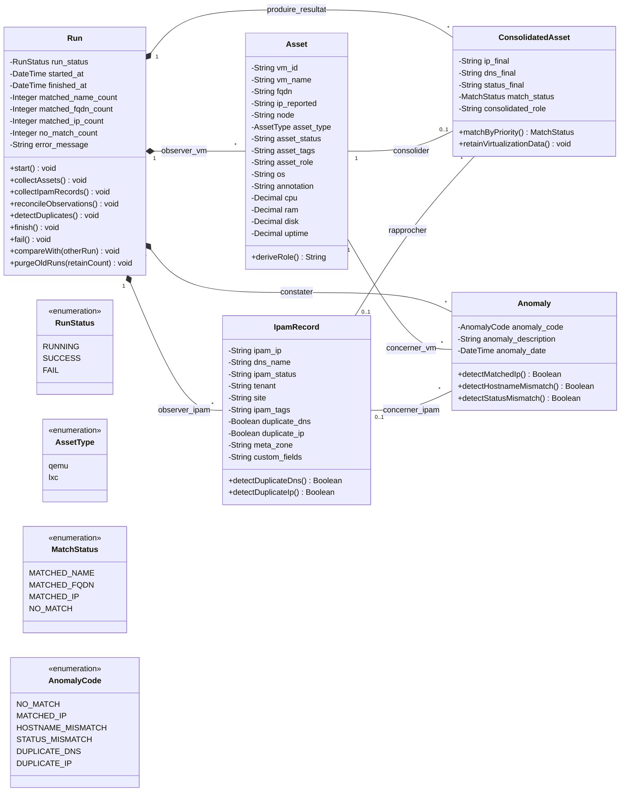

## Diagramme

## Classes

- Run — entité RUN ; RG01, RG07, RG19–RG20, RG22–RG23, RG25–RG28 (§6.1, §8.2, §8.5–§8.8) ; start()/finish() : RG19 ; fail() : RG20 ; collectAssets()/collectIpamRecords() : RG25 ; reconcileObservations() : RG26 ; detectDuplicates() : RG27 ; compareWith() : RG22 ; purgeOldRuns() : RG23.
- Asset — entité ASSET ; RG02, RG15–RG16, RG21 (§6.1, §7.3, §8.2) ; deriveRole() : RG15–RG16.
- IpamRecord — entité IPAM_RECORD ; RG03, RG07–RG08, RG17–RG18, RG24, RG35–RG36 (§6.1, §7.4, §13.2, §16) ; `custom_fields` : JSON source complet facultatif sérialisé en TEXT, NULL si absent, distinct de l'objet vide ; `meta_zone` : zone existante nullable, filtre par run via `(run_id, meta_zone)` ; detectDuplicateDns()/detectDuplicateIp() : RG17–RG18 (sur les observations du run).
- ConsolidatedAsset — entité CONSOLIDATED_ASSET ; RG04, RG09–RG10, RG14, RG22 (§6.1, §7.1–§7.2, §8.5) ; matchByPriority() : RG09–RG10 ; retainVirtualizationData() : RG14.
- Anomaly — entité ANOMALY ; RG05–RG06, RG11–RG13 (§6.1–§6.2, §7.1) ; detectMatchedIp()/detectHostnameMismatch()/detectStatusMismatch() : RG11–RG13.

## Relations

| A | Type | B | Multiplicité côté A | Multiplicité côté B | RG |
| --- | --- | --- | --- | --- | --- |
| Run | composition : observation propre à l'instantané | Asset | 1 | * | RG02, RG07, RG20 |
| Run | composition : observation propre à l'instantané | IpamRecord | 1 | * | RG03, RG07, RG20, RG24 |
| Run | composition : résultat propre à l'instantané | ConsolidatedAsset | 1 | * | RG04, RG07, RG20 |
| Run | composition : constat propre à l'instantané | Anomaly | 1 | * | RG05, RG20 |
| Asset | association : observation et résultat distincts | ConsolidatedAsset | 1 | 0..1 | RG04, RG20 |
| IpamRecord | association : observation conservée sans résultat | ConsolidatedAsset | 0..1 | * | RG03, RG08–RG09, RG14 |
| Asset | association : constat facultatif | Anomaly | 0..1 | * | RG05–RG06, RG14 |
| IpamRecord | association : constat facultatif | Anomaly | 0..1 | * | RG05, RG08, RG17–RG18 |

## Limites Mermaid

- Les identifiants internes et les clés de liaison du MLD/SQL sont représentés par l'identité des objets et les associations, sans attribut `id` ni FK ; les multiplicités croisent les cardinalités du MCD (RG02–RG05, §6.1–§6.3).
- Chaque référence Asset ou IpamRecord d'un résultat ou d'une anomalie doit appartenir au même Run : contrainte transversale non exprimable par une seule association (RG04–RG05, §6.1, §8.5).
- Les opérations de rapprochement et de détection parcourent plusieurs observations d'un même run ; leur signature UML ne spécifie pas le service transactionnel ni le traitement des exceptions (RG09, RG17–RG18, RG28, §7.1, §7.4, §8.2).
- Les types source, les unités des métriques, les tags, les statuts et la portée des doublons restent à confirmer (Q1–Q6, §6.1, §7.3–§7.4). Les énumérations indiquent uniquement les valeurs déjà prescrites.
- Les clés et types internes de `custom_fields` restent à confirmer (Q8) ; l'objet complet est conservé par observation, sans inventer de clé ni d'association (RG35).
