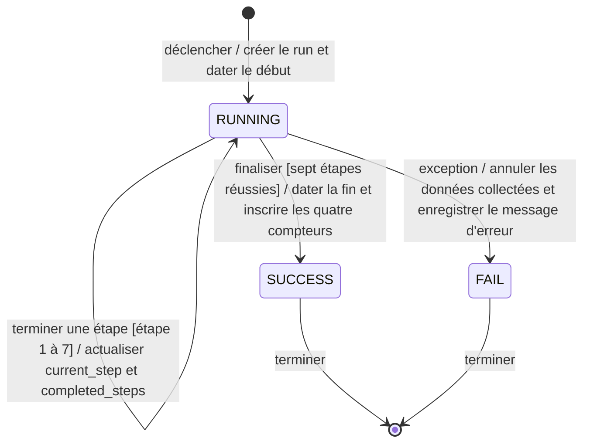
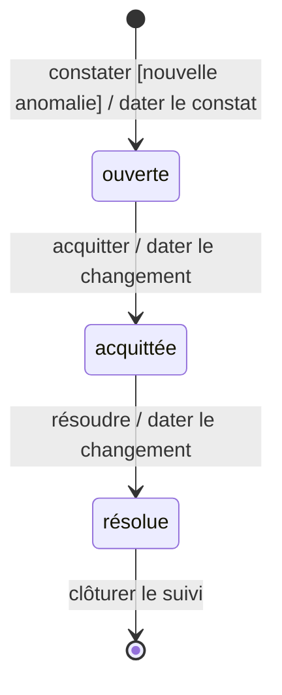

# États — Run

## Diagramme

## Légende

- `[*]` marque l'entrée et la fin du cycle ; les flèches portent événement, garde éventuelle et effet. `RUNNING`, `SUCCESS`, `FAIL` sont les seules valeurs autorisées par `run.status` et `Run.run_status` (`RunStatus`).
- La fin du cycle n'est pas une suppression du run : son historique demeure. Après rollback, l'échec doit rester enregistré ; le diagramme ne prescrit pas la mécanique transactionnelle de cette persistance.
- Un déclenchement manuel ou planifié crée son propre `Run` ; `run_trigger` et le lien facultatif vers `RunSchedule` indiquent la provenance, sans changer les trois statuts. Les observations `Asset.virtual_source` et `IpamRecord.ipam_source` qualifient leur origine par run ; deux `vm_id` égaux d'origines différentes ne sont pas fusionnés. `SnapshotObservation` et `BackupObservation` référencent chacune `Run` et la VM `Asset` de ce même run ; `NodeCapacityObservation` conserve la mesure par run et nœud (RG59, RG73). La boucle de progression représente les sept étapes, sans imposer la valeur du compteur après échec (Q13).

## Traçabilité

| Transition | Règles et cahier des charges |
| --- | --- |
| Déclencher → RUNNING | RG19, RG25 ; §8.2, étapes 1–3 |
| Terminer une étape RUNNING → RUNNING | RG46, RG48, RG25–RG28 ; §20 EV30, §8.2 |
| Finaliser RUNNING → SUCCESS | RG19, RG26–RG28 ; §8.2, étapes 4–7 |
| Exception RUNNING → FAIL | RG20, RG28 ; §8.2, rollback |
| SUCCESS / FAIL → fin du cycle | RG07, RG19–RG20 ; §8.2, §8.5 |

Les origines des observations et la conservation des runs historiques relèvent de RG49–RG51 et RG58 ; elles ne créent aucune transition d'état supplémentaire.
Les mesures et observations historiques v3 relèvent de RG59, RG73 et RG75 ; le score et le doute facultatifs du résultat `ConsolidatedAsset` (RG61), les contrôles conditionnels RG60 et RG62–RG72 ainsi que la prévision éventuellement impossible (RG74) ne modifient pas les trois statuts de `Run`.

## Non représenté

- Le SQL vérifie uniquement l'ensemble des statuts, non les transitions, les gardes ou la présence conditionnelle des dates, compteurs et erreur ; ces invariants relèvent du traitement applicatif.
- Les statuts source des VM et de l'IPAM (Q2) ne sont pas des états du run.
- Le déclenchement par `RunSchedule` (RG47–RG48) et la cadence sont hors du cycle d'état du run ; Q13–Q15 restent ouvertes.
- La purge de runs n'efface pas les traces `Audit` de lancement, acquittement, purge et modification : auteur historique, action, date et cible restent consultables (RG57–RG58, Q19). L'audit n'est pas un état du run.
- Une mesure absente, une collecte de sauvegarde indisponible ou une prévision impossible ne sont pas des transitions vers `FAIL` : les contrôles correspondants restent indéterminés faute de données (RG72–RG75, Q20–Q25). Aucun historique v2 ne reçoit de constat ou de mesure v3 fictifs (RG75).

# États — Anomaly

## Diagramme

## Légende

- `[*]` désigne l'entrée et la fin du suivi, sans suppression du constat ; les flèches portent événement, garde éventuelle et effet. `Ouverte`, `Acquittee`, `Resolue` correspondent aux valeurs `ouverte`, `acquittée`, `résolue` de `Anomaly.anomaly_state` (`AnomalyState`) ; `state_changed_at` date les changements.
- Le suivi se rattache à une cible stable entre runs via `Anomaly.tracking_key` ; les constats `Anomaly` propres à chaque `Run` demeurent historiques. Une exception applicable filtre le constat avant son ouverture, sans devenir un état. Les codes candidats v3 (réseau, conformité, capacité, zombie, absence confirmée de sauvegarde et snapshot oublié) empruntent le même cycle ; la sévérité par code demeure indéterminée tant que sa classification n'est pas fixée (RG60, RG62–RG72, RG76, Q26).

## Traçabilité

| Transition | Règles et cahier des charges |
| --- | --- |
| Constater → ouverte | RG41–RG42, RG05 ; §18 EV14 |
| Acquitter ouverte → acquittée | RG41–RG42 ; §18 EV14 |
| Résoudre acquittée → résolue | RG41–RG42 ; §18 EV14 |
| Résolue → fin du suivi | RG41–RG42 ; §18 EV14 |
| Constater un code v3 → ouverte, si données suffisantes et sans exception applicable | RG45, RG60, RG62–RG72, RG76 ; §17 EV09, §18 EV17–EV21 |

## Non représenté

- La fin est une convention graphique, non une transition métier supplémentaire ni une suppression. Aucun retour vers ouverte ni passage direct à résolue n'est prescrit. L'identité exacte inter-runs et la durée à mesurer restent à préciser (Q9) ; les critères code, cible et expiration des exceptions relèvent de RG45, non du cycle d'état.
- Le doute du matching (RG61) n'est pas un nouvel état d'anomalie et aucun code dédié n'est prescrit. L'absence de collecte ne prouve pas l'absence de sauvegarde (RG72) ; seuils et dates d'oubli, durée N et classification des nouveaux codes restent à préciser (Q20–Q26).
