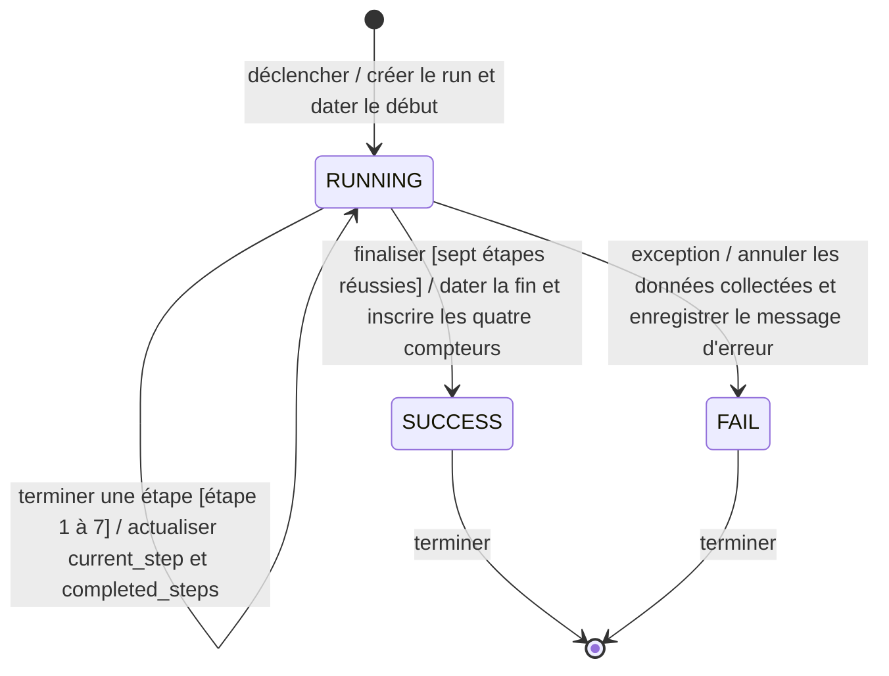
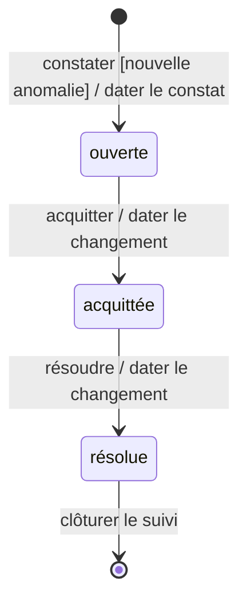

# États — Run

## Diagramme

## Légende

- `[*]` marque l'entrée et la fin du cycle ; les flèches portent événement, garde éventuelle et effet. `RUNNING`, `SUCCESS`, `FAIL` sont les seules valeurs autorisées par `run.status` et `Run.run_status` (`RunStatus`).
- La fin du cycle n'est pas une suppression du run : son historique demeure. Après rollback, l'échec doit rester enregistré ; le diagramme ne prescrit pas la mécanique transactionnelle de cette persistance.
- Un déclenchement manuel ou planifié crée son propre `Run` ; `run_trigger` et le lien facultatif vers `RunSchedule` indiquent la provenance, sans changer les trois statuts. Les observations `Asset.virtual_source` et `IpamRecord.ipam_source` qualifient leur origine par run ; deux `vm_id` égaux d'origines différentes ne sont pas fusionnés. La boucle de progression représente les sept étapes, sans imposer la valeur du compteur après échec (Q13).

## Traçabilité

| Transition | Règles et cahier des charges |
| --- | --- |
| Déclencher → RUNNING | RG19, RG25 ; §8.2, étapes 1–3 |
| Terminer une étape RUNNING → RUNNING | RG46, RG48, RG25–RG28 ; §20 EV30, §8.2 |
| Finaliser RUNNING → SUCCESS | RG19, RG26–RG28 ; §8.2, étapes 4–7 |
| Exception RUNNING → FAIL | RG20, RG28 ; §8.2, rollback |
| SUCCESS / FAIL → fin du cycle | RG07, RG19–RG20 ; §8.2, §8.5 |

Les origines des observations et la conservation des runs historiques relèvent de RG49–RG51 et RG58 ; elles ne créent aucune transition d'état supplémentaire.

## Non représenté

- Le SQL vérifie uniquement l'ensemble des statuts, non les transitions, les gardes ou la présence conditionnelle des dates, compteurs et erreur ; ces invariants relèvent du traitement applicatif.
- Les statuts source des VM et de l'IPAM (Q2) ne sont pas des états du run.
- Le déclenchement par `RunSchedule` (RG47–RG48) et la cadence sont hors du cycle d'état du run ; Q13–Q15 restent ouvertes.
- La purge de runs n'efface pas les traces `Audit` de lancement, acquittement, purge et modification : auteur historique, action, date et cible restent consultables (RG57–RG58, Q19). L'audit n'est pas un état du run.

# États — Anomaly

## Diagramme

## Légende

- `[*]` désigne l'entrée et la fin du suivi, sans suppression du constat ; les flèches portent événement, garde éventuelle et effet. `Ouverte`, `Acquittee`, `Resolue` correspondent aux valeurs `ouverte`, `acquittée`, `résolue` de `Anomaly.anomaly_state` (`AnomalyState`) ; `state_changed_at` date les changements.
- Le suivi se rattache à une cible stable entre runs via `Anomaly.tracking_key` ; les constats `Anomaly` propres à chaque `Run` demeurent historiques. Une exception applicable filtre le constat avant son ouverture, sans devenir un état.

## Traçabilité

| Transition | Règles et cahier des charges |
| --- | --- |
| Constater → ouverte | RG41–RG42, RG05 ; §18 EV14 |
| Acquitter ouverte → acquittée | RG41–RG42 ; §18 EV14 |
| Résoudre acquittée → résolue | RG41–RG42 ; §18 EV14 |
| Résolue → fin du suivi | RG41–RG42 ; §18 EV14 |

## Non représenté

- La fin est une convention graphique, non une transition métier supplémentaire ni une suppression. Aucun retour vers ouverte ni passage direct à résolue n'est prescrit. L'identité exacte inter-runs et la durée à mesurer restent à préciser (Q9) ; les critères code, cible et expiration des exceptions relèvent de RG45, non du cycle d'état.
