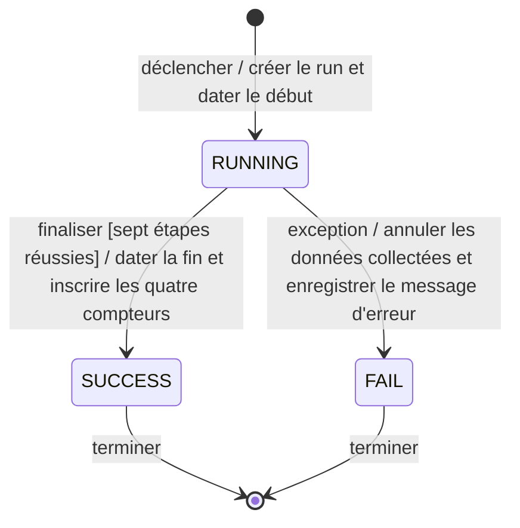

# États — Run

## Diagramme

## Légende

- `[*]` marque l'entrée et la fin du cycle ; les flèches portent événement, garde éventuelle et effet. `RUNNING`, `SUCCESS`, `FAIL` sont les seules valeurs autorisées par `run.status` et `Run.run_status` (`RunStatus`).
- La fin du cycle n'est pas une suppression du run : son historique demeure. Après rollback, l'échec doit rester enregistré ; le diagramme ne prescrit pas la mécanique transactionnelle de cette persistance.

## Traçabilité

| Transition | Règles et cahier des charges |
| --- | --- |
| Déclencher → RUNNING | RG19, RG25 ; §8.2, étapes 1–3 |
| Finaliser RUNNING → SUCCESS | RG19, RG26–RG28 ; §8.2, étapes 4–7 |
| Exception RUNNING → FAIL | RG20, RG28 ; §8.2, rollback |
| SUCCESS / FAIL → fin du cycle | RG07, RG19–RG20 ; §8.2, §8.5 |

## Non représenté

- Le SQL vérifie uniquement l'ensemble des statuts, non les transitions, les gardes ou la présence conditionnelle des dates, compteurs et erreur ; ces invariants relèvent du traitement applicatif.
- Les statuts source des VM et de l'IPAM (Q2) ne sont pas des états du run.
