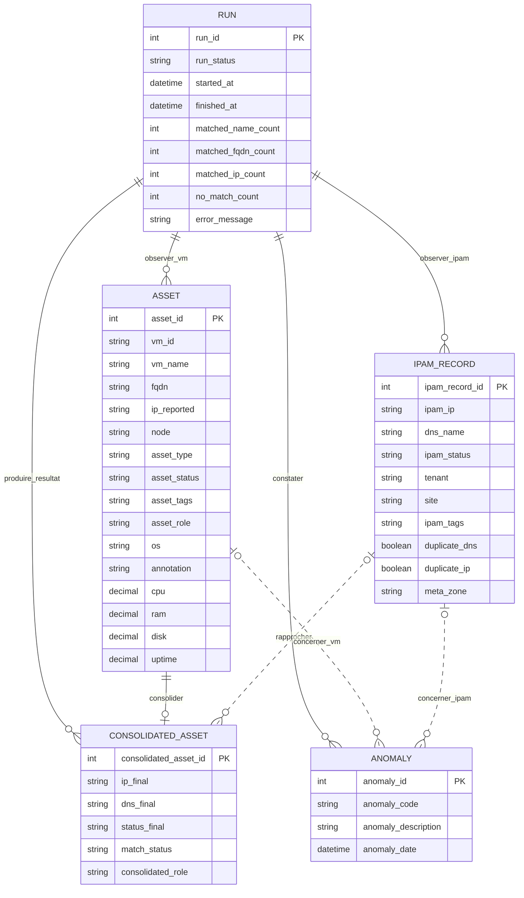

## Diagramme

Les identifiants de liaison du dictionnaire sont représentés par les associations, non répétés comme attributs conceptuels. Les liens vers RUN sont identifiants pour l'appartenance à un instantané ; les rapprochements facultatifs sont non identifiants. Aucun caractère IP ou DNS n'est unique dans IPAM_RECORD (RG8). Chaque lien vers ASSET ou IPAM_RECORD doit viser le RUN du résultat ou de l'anomalie (RG4, RG5, RG7).

## Entités

| Entité (RG) | Identifiant | Attributs conceptuels : type (longueur) ; référence au dictionnaire |
| --- | --- | --- |
| RUN (RG1, RG7, RG19) | run_id : entier | run_status : énumération RUNNING/SUCCESS/FAIL ; started_at, finished_at : datetime ; matched_name_count, matched_fqdn_count, matched_ip_count, no_match_count : entier ; error_message : texte (non précisée). |
| ASSET (RG2, RG7, RG21) | asset_id : entier | vm_id : texte à confirmer (non précisée) ; vm_name, fqdn, ip_reported, node : texte (non précisée) ; asset_type : énumération qemu/lxc ; asset_status, asset_tags : texte à confirmer (non précisée) ; asset_role, os, annotation : texte (non précisée) ; cpu, ram, disk, uptime : décimal, précision et unités à confirmer. |
| IPAM_RECORD (RG3, RG8, RG24) | ipam_record_id : entier | ipam_ip, dns_name : texte (non précisée, doublons admis) ; ipam_status, ipam_tags : texte à confirmer (non précisée) ; tenant, site, meta_zone : texte (non précisée) ; duplicate_dns, duplicate_ip : booléen. |
| CONSOLIDATED_ASSET (RG4, RG7, RG14, RG22) | consolidated_asset_id : entier | ip_final, dns_final, consolidated_role : texte (non précisée) ; status_final : texte à confirmer (non précisée) ; match_status : énumération MATCHED_NAME/MATCHED_FQDN/MATCHED_IP/NO_MATCH. |
| ANOMALY (RG5, RG6) | anomaly_id : entier | anomaly_code : énumération NO_MATCH/MATCHED_IP/HOSTNAME_MISMATCH/STATUS_MISMATCH/DUPLICATE_DNS/DUPLICATE_IP ; anomaly_description : texte (non précisée) ; anomaly_date : datetime. |

Chaque identifiant interne est distinct entre runs ; vm_id sert d'identité source par run, sans imposer ici une unicité intra-run non confirmée (RG21, Q1). Tous les autres champs ont pour longueur « non précisée » quand aucune longueur n'est indiquée ci-dessus ; les dates, compteurs, booléens et énumérations n'ont pas de longueur prescrite.

## Associations

Les cardinalités indiquent la participation de chaque occurrence de l'entité nommée, indépendamment de la position du symbole Mermaid (lecture croisée).

| Nom | Entité A | Card. A | Entité B | Card. B | Attributs portés | RG |
| --- | --- | --- | --- | --- | --- | --- |
| observer_vm | RUN | (0,n) RG2, RG20 | ASSET | (1,1) RG2, RG7 | aucun | RG2, RG7, RG20 |
| observer_ipam | RUN | (0,n) RG3, RG20 | IPAM_RECORD | (1,1) RG3, RG7 | aucun | RG3, RG7, RG20, RG24 |
| produire_resultat | RUN | (0,n) RG4, RG20 | CONSOLIDATED_ASSET | (1,1) RG4 | aucun | RG4, RG7, RG20 |
| constater | RUN | (0,n) RG5, RG20 | ANOMALY | (1,1) RG5 | aucun | RG5, RG20 |
| consolider | ASSET | (0,1) RG2, RG4, RG20 | CONSOLIDATED_ASSET | (1,1) RG4 | aucun | RG4, RG20 |
| rapprocher | IPAM_RECORD | (0,n) RG3, RG8, RG9 | CONSOLIDATED_ASSET | (0,1) RG9, RG14 | aucun | RG3, RG8, RG9, RG14 |
| concerner_vm | ASSET | (0,n) RG5, RG6 | ANOMALY | (0,1) RG5 | aucun | RG5, RG6, RG14 |
| concerner_ipam | IPAM_RECORD | (0,n) RG5, RG8, RG17, RG18 | ANOMALY | (0,1) RG5 | aucun | RG5, RG8, RG17, RG18 |

Une anomalie peut ne référencer ni VM ni IPAM lorsque son constat est attaché au seul run ; ces deux références sont indépendamment facultatives (RG5). Une VM sans IPAM reste consolidable avec NO_MATCH et uniquement ses données de virtualisation ; un enregistrement IPAM non rapproché reste présent (RG3, RG14). Plusieurs anomalies peuvent concerner le même enregistrement sans fusionner les doublons (RG5, RG8).

## Traçabilité

| élément | nature | RG |
| --- | --- | --- |
| RUN | entité, statut et compteurs | RG1, RG7, RG19, RG20, RG23 |
| ASSET | entité, observation VM/CT et identité source | RG2, RG7, RG15, RG16, RG21 |
| IPAM_RECORD | entité, observation autonome, doublons, zone et statut | RG3, RG8, RG17, RG18, RG24 |
| CONSOLIDATED_ASSET | entité, instantané par run | RG4, RG7, RG9, RG10, RG14, RG22 |
| ANOMALY | entité, codes et constat | RG5, RG6, RG11, RG12, RG13, RG17, RG18 |
| observer_vm ; RUN (0,n), ASSET (1,1) | association et cardinalités | RG2, RG7, RG20 |
| observer_ipam ; RUN (0,n), IPAM_RECORD (1,1) | association et cardinalités | RG3, RG7, RG20 |
| produire_resultat ; RUN (0,n), CONSOLIDATED_ASSET (1,1) | association et cardinalités | RG4, RG7, RG20 |
| constater ; RUN (0,n), ANOMALY (1,1) | association et cardinalités | RG5, RG20 |
| consolider ; ASSET (0,1), CONSOLIDATED_ASSET (1,1) | association et cardinalités | RG2, RG4, RG20 |
| rapprocher ; IPAM_RECORD (0,n), CONSOLIDATED_ASSET (0,1) | association et cardinalités | RG3, RG8, RG9, RG14 |
| concerner_vm ; ASSET (0,n), ANOMALY (0,1) | association et cardinalités | RG5, RG6, RG14 |
| concerner_ipam ; IPAM_RECORD (0,n), ANOMALY (0,1) | association et cardinalités | RG5, RG8, RG17, RG18 |

## Écarts et questions

- Q1 : type et unicité intra-run de vm_id à confirmer ; ne pas confondre identité source et identifiant d'observation (RG21).
- Q2 : vocabulaire des statuts VM, IPAM et consolidé nécessaire pour qualifier « arrêtée » et « active » (RG9, RG13, RG22).
- Q3 : encodage/cardinalité des tags à confirmer ; conserver la valeur source et analyser role:xxx lorsqu'il existe (RG16).
- Q4 : unités et précision des quatre métriques à confirmer ; aucune conversion implicite (RG2).
- Q5 : sens précis des quatre compteurs en cas de correspondances multiples ; une seule catégorie retenue par VM selon l'ordre RG9 (RG19).
- Q6 : portée d'une anomalie de doublon par groupe ou par enregistrement à confirmer ; toutes les lignes IPAM sont conservées (RG17, RG18).
- La contrainte « référence du même run » (RG4, RG5) traverse deux associations et doit être contrôlée au niveau logique ; le MCD ne lui attribue aucun champ supplémentaire.
