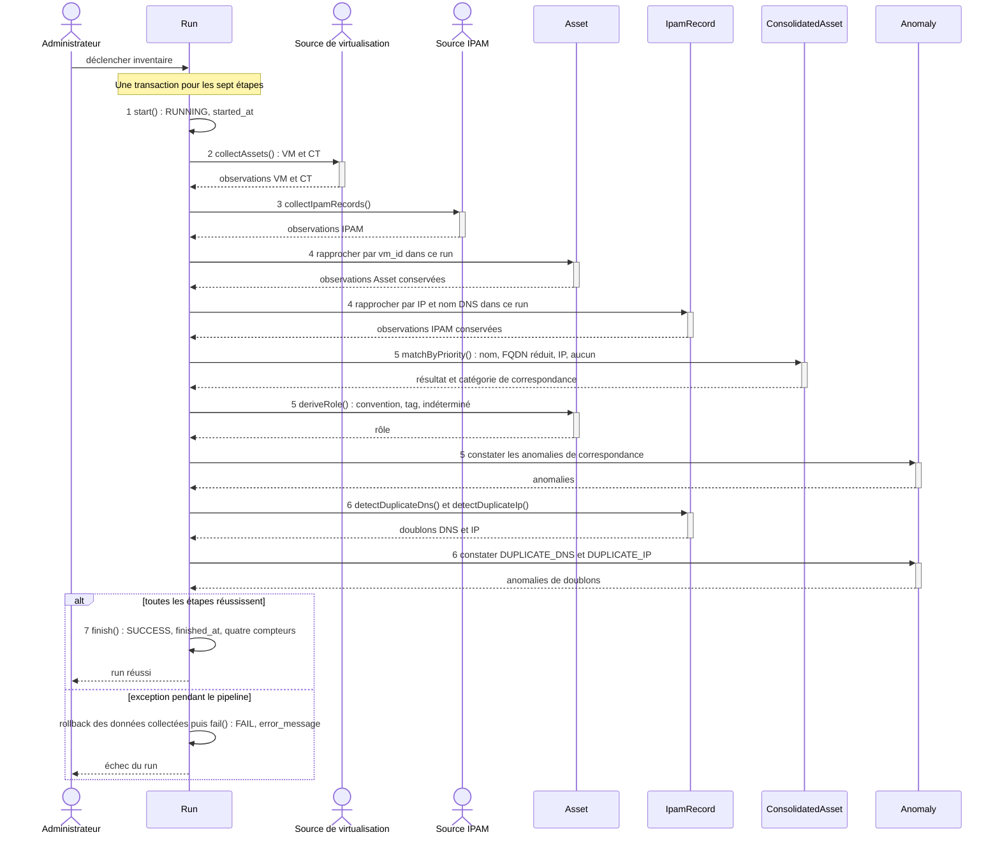
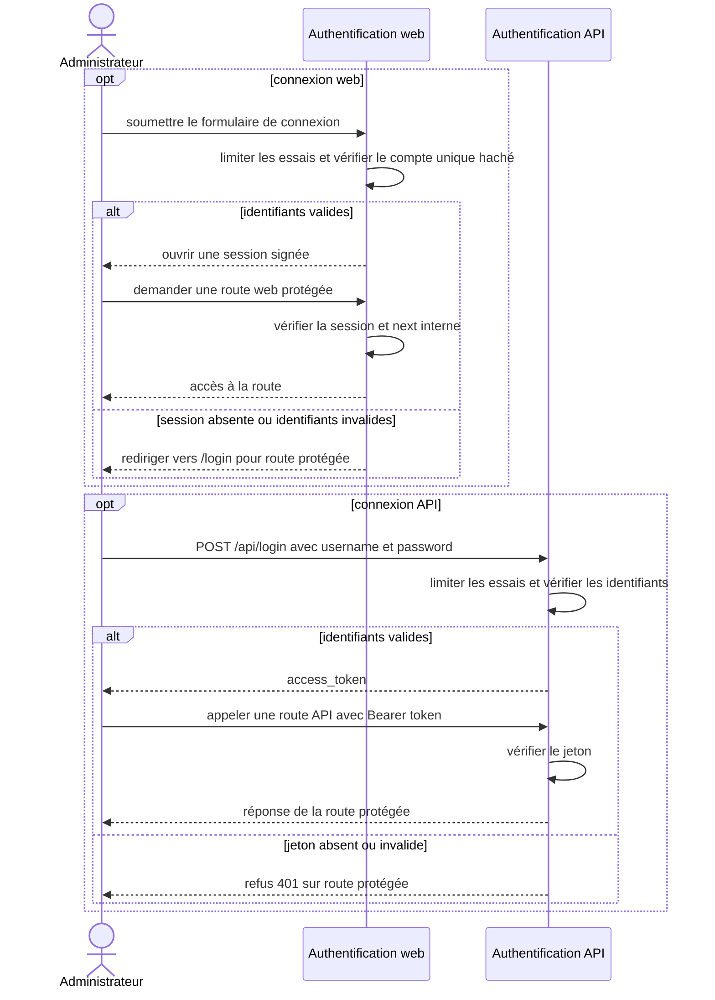

# Séquences — Pipeline et authentification

## Diagramme — pipeline d'un run

## Légende — pipeline

- Flèche pleine : appel ou résultat ; `alt` : réussite ou exception. `Run`, `Asset`, `IpamRecord`, `ConsolidatedAsset` et `Anomaly` sont les classes du modèle ; l'administrateur et les deux sources sont les acteurs des règles.
- Les étapes 1–7 sont ordonnées ; l'étape 4 représente la conservation/rapprochement intra-run, sans imposer de primitive SQL d'upsert absente du schéma. La branche d'exception peut survenir à chacune des étapes, et non uniquement après la détection des doublons.

## Traçabilité — pipeline

| Échanges | Règles et cahier des charges |
| --- | --- |
| Déclenchement et étape 1 | RG19 ; §8.2, étape 1 |
| Étapes 2–3 : deux collectes | RG02–RG03, RG25 ; §8.2, étapes 2–3 |
| Étape 4 : observations propres au run | RG07, RG21, RG24, RG26 ; §6.3, §8.2, étape 4 |
| Étape 5 : priorité, rôle, anomalies | RG09–RG16, RG26 ; §7.1–§7.3, §8.2, étape 5 |
| Étape 6 : doublons | RG08, RG17–RG18, RG27 ; §7.4, §8.2, étape 6 |
| Étape 7 et exception | RG19–RG20, RG28 ; §8.2, étape 7 et rollback |

## Non représenté — pipeline

- Les multiplicités d'observations sont implicites ; Q1–Q6 ne fixent ni conversions source, ni arbitrage de plusieurs correspondances, ni granularité définitive des doublons. Le modèle n'introduit aucun statut ou anomalie supplémentaire.
- Le mécanisme de persistance de FAIL après annulation de la transaction unique n'est pas prescrit ; la trace montre l'obligation métier sans inventer sa mise en œuvre.

## Diagramme — authentification web et API

## Légende — authentification

- `opt` distingue les deux chemins possibles, sans les rendre simultanément obligatoires ; `alt` expose l'accès autorisé ou le refus. `Administrateur` est l'acteur défini dans les règles ; `Authentification web` et `Authentification API` sont des composants d'interface, non des entités persistées du diagramme de classes.

## Traçabilité — authentification

| Échanges | Règles et cahier des charges |
| --- | --- |
| Connexion et session web signée, compte unique haché | RG29 ; §10.1 |
| Route web protégée et redirection /login | RG30 ; §10.1 |
| Limitation des essais et next interne | RG33–RG34 ; §10, rubrique « Sécurité » |
| POST /api/login et access_token | RG31 ; §9.2 |
| Bearer valide ou refus 401 | RG32 ; §9.2, §9.5, §10.2 |

## Non représenté — authentification

- La gestion des erreurs de formulaire et la durée de vie des sessions et jetons ne sont pas définies ici ; Q7 laisse ouvert le mécanisme de stockage de la session et du compte, sans ajouter d'entité au modèle.
- Les autres protections transverses du §10 ne constituent pas des étapes supplémentaires de connexion dans ces scénarios.
