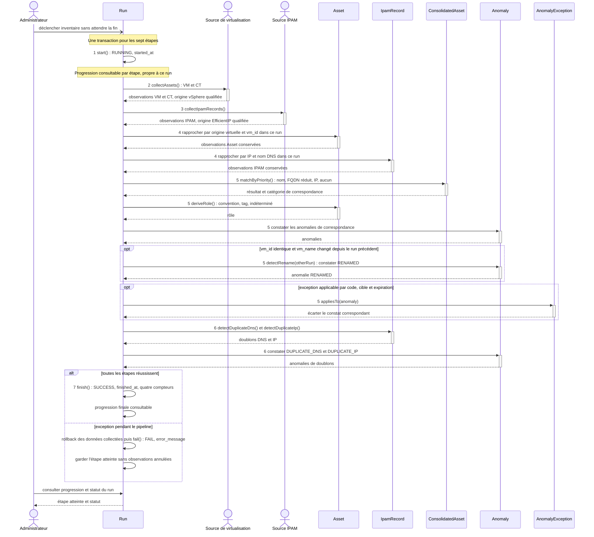
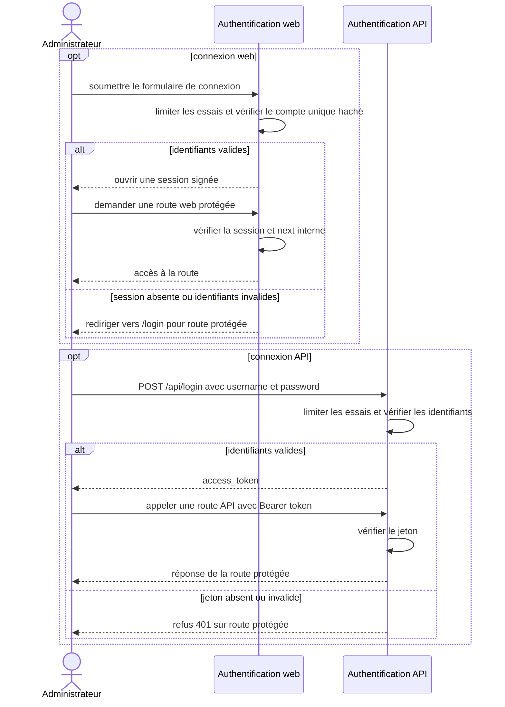
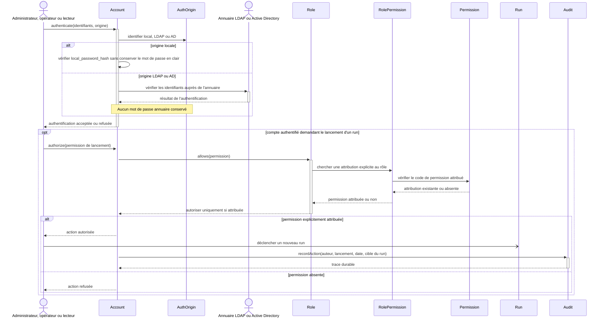

# Séquences — Pipeline et authentification

## Diagramme — pipeline d'un run

## Légende — pipeline

- Flèche pleine : appel ou résultat ; flèche asynchrone : lancement non bloquant ; `alt` : réussite ou exception ; `opt` : traitement conditionnel. `Run`, `Asset`, `IpamRecord`, `ConsolidatedAsset`, `Anomaly` et `AnomalyException` sont les classes du modèle ; l'administrateur et les deux sources sont les acteurs des règles.
- Les étapes 1–7 sont ordonnées ; l'étape 4 représente la conservation/rapprochement intra-run, sans imposer de primitive SQL d'upsert absente du schéma. La branche d'exception peut survenir à chacune des étapes, et non uniquement après la détection des doublons.
- `Asset.virtual_source` et `IpamRecord.ipam_source` conservent la provenance des valeurs reçues dans chaque run, même pour un enregistrement IPAM sans VM ; aucun `vm_id` d'une autre source n'est assimilé sur sa seule valeur. Les constats et observations des anciens runs ne sont pas écrasés.

## Traçabilité — pipeline

| Échanges | Règles et cahier des charges |
| --- | --- |
| Déclenchement et étape 1 | RG19 ; §8.2, étape 1 |
| Étapes 2–3 : deux collectes | RG02–RG03, RG25 ; §8.2, étapes 2–3 |
| Étape 4 : observations propres au run | RG07, RG21, RG24, RG26 ; §6.3, §8.2, étape 4 |
| Étape 5 : priorité, rôle, anomalies | RG09–RG16, RG26 ; §7.1–§7.3, §8.2, étape 5 |
| Étape 6 : doublons | RG08, RG17–RG18, RG27 ; §7.4, §8.2, étape 6 |
| Étape 7 et exception | RG19–RG20, RG28 ; §8.2, étape 7 et rollback |
| Renommage et exception applicable | RG39–RG40, RG44–RG45 ; §18 EV12, EV15 |
| Lancement non bloquant et consultation par étape | RG46, RG48 ; §20 EV30 |
| Collecte qualifiée vSphere et EfficientIP, identité distincte par origine | RG49–RG51, RG58 ; §17 EV01–EV02, §23 EV59 |

## Non représenté — pipeline

- Les multiplicités d'observations sont implicites ; Q1–Q6 ne fixent ni conversions source, ni arbitrage de plusieurs correspondances, ni granularité définitive des doublons. Le modèle n'introduit aucun statut ou anomalie supplémentaire.
- Le mécanisme de persistance de FAIL après annulation de la transaction unique n'est pas prescrit ; la trace montre l'obligation métier sans inventer sa mise en œuvre.
- Les sept étapes actualisent la progression (RG46) sans fixer les valeurs finales après rollback (Q13). Le planificateur externe peut déclencher un nouveau run selon `RunSchedule` (RG47–RG48), mais sa cadence et son fuseau restent hors de ce scénario manuel (Q15). Le suivi ouverte → acquittée → résolue est détaillé dans `etats.md`, pas dans le pipeline.
- L'autorisation d'un lancement et sa trace d'audit sont illustrées dans le scénario d'accès ci-dessous ; elles ne modifient ni les sept étapes ni le cycle du run.

## Diagramme — authentification web et API

## Légende — authentification

- `opt` distingue les deux chemins possibles, sans les rendre simultanément obligatoires ; `alt` expose l'accès autorisé ou le refus. `Administrateur` est l'acteur défini dans les règles ; `Authentification web` et `Authentification API` sont des composants d'interface, non des entités persistées du diagramme de classes.

## Traçabilité — authentification

| Échanges | Règles et cahier des charges |
| --- | --- |
| Connexion et session web signée, compte unique haché | RG29 ; §10.1 |
| Route web protégée et redirection /login | RG30 ; §10.1 |
| Limitation des essais et next interne | RG33–RG34 ; §10, rubrique « Sécurité » |
| POST /api/login et access_token | RG31 ; §9.2 |
| Bearer valide ou refus 401 | RG32 ; §9.2, §9.5, §10.2 |

## Non représenté — authentification

- La gestion des erreurs de formulaire et la durée de vie des sessions et jetons ne sont pas définies ici ; Q7 laisse ouvert le mécanisme de stockage de la session et du compte, sans ajouter d'entité au modèle.
- Les autres protections transverses du §10 ne constituent pas des étapes supplémentaires de connexion dans ces scénarios.

## Diagramme — accès authentifié et audit v2.3

## Légende — accès et audit

- `alt` distingue les origines locale et annuaire, puis autorisation ou refus ; `opt` limite la demande d'action aux comptes authentifiés. La flèche asynchrone lance le run sans attendre son achèvement. `Account`, `AuthOrigin`, `Role`, `RolePermission`, `Permission`, `Run` et `Audit` sont les classes du modèle ; utilisateur et annuaire sont les acteurs des règles.
- `Account.local_password_hash` n'existe que pour l'origine locale ; l'annuaire authentifie sans empreinte ni mot de passe applicatif. Une permission n'est accordée que par l'association explicite `RolePermission`, sans matrice présumée. `Audit.audit_actor_identity`, `audit_action`, `audit_date` et `audit_target` restent durables après purge de runs.

## Traçabilité — accès et audit

| Échanges | Règles et cahier des charges |
| --- | --- |
| Compte distinct et origine locale ou annuaire | RG53–RG56 ; §22 EV48–EV49 |
| Autorisation par rôle et permission attribuée | RG52 ; §22 EV48 |
| Trace du lancement, auteur, action, date et cible durables | RG57–RG58 ; §22 EV52, §23 EV59 |

## Non représenté — accès et audit

- La matrice effective des permissions, l'association entre identités d'origines différentes et la rétention des audits restent ouvertes (Q17–Q19). Acquittement, purge et modification suivent la même obligation de trace après autorisation ; aucun droit n'est inventé pour ces opérations. La purge des runs ne purge pas les audits.
- La représentation d'une authentification acceptée ou refusée est condensée en réponse ; seuls les comptes effectivement authentifiés peuvent demander l'autorisation. La forme des échanges réseau avec l'annuaire n'est pas prescrite.
